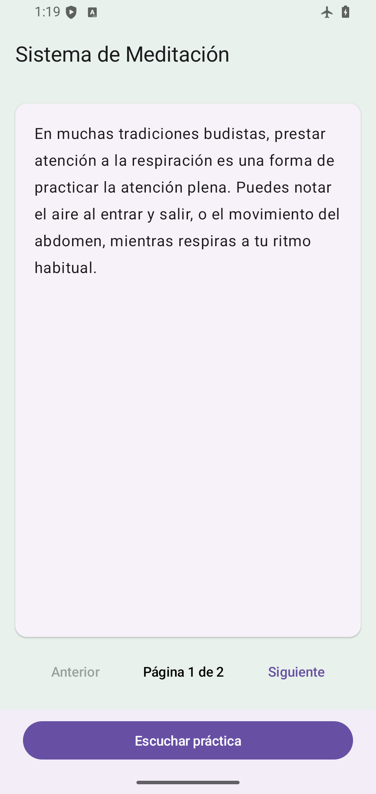
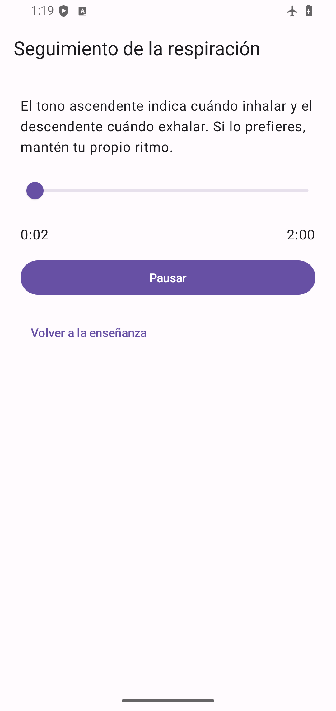
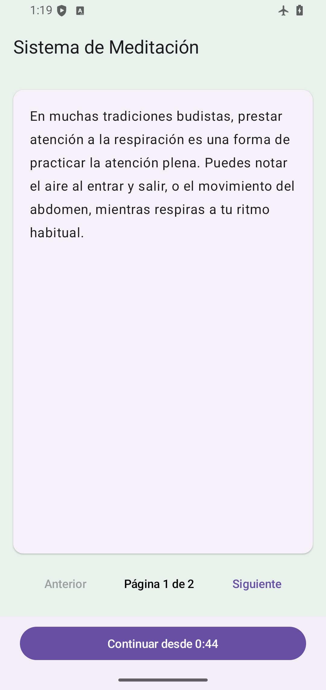

# Ava · Noble Sendero

Ava es una aplicación Android en español para leer enseñanzas budistas y acompañarlas con meditación. Este repositorio incluye la **app completa** y una **demo sin cuenta** para recorrer la enseñanza, escuchar una práctica y recuperar el avance en modo avión.

<p>
  
  
  
</p>

[APK de la demo y video del recorrido](https://github.com/AntonioWalls/Ava-Android/releases/tag/v0.2.0)

## Qué incluye

| Módulo | Funciones |
| --- | --- |
| `:app` | Cuenta, perfil, enseñanzas, cuatro meditaciones, foro y conversaciones entre usuarios. |
| `:demo` | Enseñanza, práctica de respiración de dos minutos y avance local. Incluye reproducción con la pantalla bloqueada. |
| `:lessons` | Lector Compose y medidas compartidas de la interfaz. |

Kotlin, Jetpack Compose, Media3, Firebase Authentication, Cloud Firestore y Cloud Storage. Cada módulo guarda sus textos en `res/values/strings.xml`. Las medidas de Compose están en [UiDimensions.kt](lessons/src/main/java/com/antoniowalls/ava/design/UiDimensions.kt).

## Ejecutar en local

Usa JDK 21, Android SDK 35 y el Gradle Wrapper. En Windows, cambia `./gradlew` por `gradlew.bat`.

```sh
./gradlew :demo:installDebug
```

La app completa viene configurada para un proyecto ficticio de Firebase. Inicia los emuladores con el Firebase CLI y ejecuta la app desde un emulador de Android.

```sh
firebase emulators:start --project demo-ava-local --only auth,firestore,storage
./gradlew :app:installDebug
```

Crea cuentas de prueba desde la app. La interfaz de Firebase Emulator Suite queda en `http://127.0.0.1:4000`. Los servicios permanecen en tu máquina y la app Android los alcanza mediante `10.0.2.2`.

Para conectar un proyecto de Firebase de desarrollo, coloca tu propio `google-services.json` en `app/` y compila con `-PavaCloudFirebase=true`. Mantén fuera de Git ese archivo, cualquier cuenta de servicio y las claves de firma. Para usar un backend ya existente, revisa primero la migración del directorio y las conversaciones, porque las reglas y los datos de esta entrega usan el esquema documentado. [Configuración y verificación de Firebase](docs/FIREBASE.md)

## Pruebas

```sh
./gradlew :app:testDebugUnitTest :app:lintDebug :demo:lintDebug
./gradlew :demo:connectedDebugAndroidTest
node tools/check-backend.mjs
```

La última comprobación usa los emuladores de Firebase activos y Node.js 22 o posterior. Crea cuentas sintéticas y verifica perfil, comentarios y conversaciones. El flujo de GitHub Actions compila el proyecto y guarda los APK de prueba.

## Créditos

Proyecto de Antonio Walls. El catálogo conserva las enseñanzas, imágenes y grabaciones del proyecto original, con permiso de redistribución confirmado por su autor. Las meditaciones acreditadas a Padmabandhu conservan ese crédito en la app. El texto breve y la pista de tonos de la demo se prepararon para este proyecto. [Generación y pruebas del audio demo](demo/README.md)
